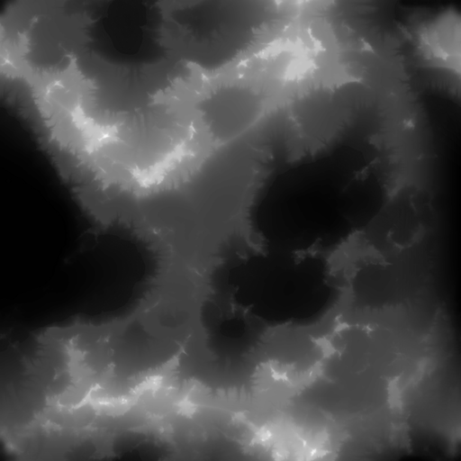
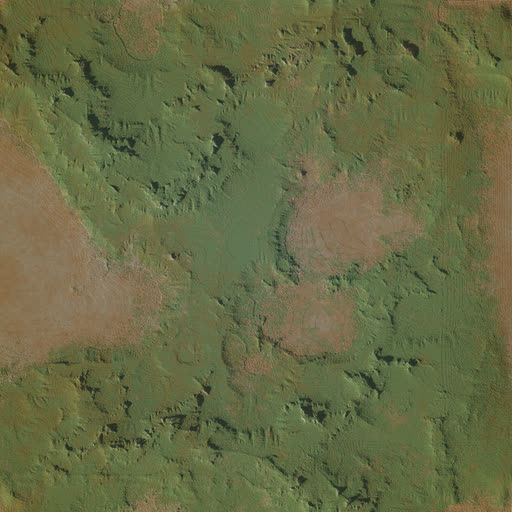
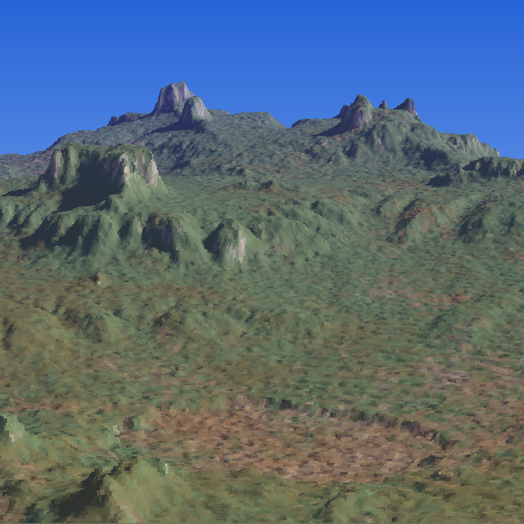

# VoxelRendering

Ancien projet C++ (janvier 2011) : moteur de rendu **voxel** logiciel de type *Comanche* / *Voxel Space*. À partir d'une carte d'altitude (*heightmap*) et d'une carte de couleur (*albedo*), il calcule une vue en perspective du terrain, sans GPU, directement dans un bitmap affiché par l'interface.

> **Projet historique datant de janvier 2011**, écrit intégralement à la main, donc sans aucune assistance d'IA (les assistants de code actuels n'existaient pas). Le code est conservé tel quel ; seuls le renommage du projet, le portage vers un `.vcxproj` et deux petits correctifs de compatibilité avec les compilateurs récents ont été faits après coup, avec l'aide d'une IA, ainsi que les évolutions récentes de l'interface et du rendu (projection inverse, ciel, contrôles clavier, export PNG). L'historique Git a été importé depuis un dépôt SVN (21 révisions, 5–22 janvier 2011).

## Principe

Le rendu part de deux images de même taille : la **heightmap** (niveaux de gris = altitude) et l'**albedo** (couleur du sol). Pour chaque colonne de l'écran, un rayon parcourt le terrain depuis la caméra et remplit les pixels visibles (projection inverse, du plus proche au plus lointain), sous un ciel en dégradé bleu.

| Heightmap (`Samples/height.tga`) | Albedo (`Samples/albedo.tga`) | Rendu |
|:---:|:---:|:---:|
|  |  |  |

Les aperçus de `docs/` sont des versions réduites (512×512) des `.tga` d'origine (1792×1792).

## Fonctionnalités

- Chargement d'une heightmap et d'un albedo (`.tga`, `.png`, `.bmp`, `.gif`… via [FreeImage](http://freeimage.sourceforge.net/)) dans deux champs distincts ; `Samples/height.tga` et `Samples/albedo.tga` sont chargés par défaut.
- Rendu voxel (case **Generate real time**, sinon bouton **Generate**) : position X/Y, hauteur et angle éditables, flèches et PageUp/PageDown pour se déplacer.
- Réglages par barres de défilement : **FOV**, **résolution** (jusqu'à 1024) et **perspective**.
- Affichage du temps de calcul par image ; écriture directe dans les `BitmapData` pour de meilleures performances.
- Export PNG daté (`<préfixe>_aaaaMMdd_HHmmss.png`) avec le bouton **Save PNG**.

## Contenu du dépôt

| Chemin | Rôle |
|---|---|
| `VoxelViewerForm.h`, `VoxelViewerForm.resx` | Interface Windows Forms (C++/CLI) |
| `VoxelRendering.cpp`, `AssemblyInfo.cpp`, `stdafx.*` | Point d'entrée et fichiers du projet |
| `src/ProcessImage.cpp`, `include/ProcessImage.h` | Moteur de rendu voxel (`ComputeVoxel`, `Move`, `Turn`, `SetFov`…) |
| `include/FreeImage.h`, `lib/FreeImage.lib`, `FreeImage.dll` | Bibliothèque FreeImage 3.9.3 |
| `docs/` | Aperçus utilisés par ce README |
| `Samples/` | Cartes d'entrée d'exemple (`height*` = altitude, `albedo*` = couleur : canyon, mer HD) ; `height.tga` / `albedo.tga` sont chargées par défaut |
| `Output/` | Images PNG exportées (créé à la demande, ignoré par Git) |
| `VoxelRendering.sln`, `.vcxproj` | Solution et projet Visual Studio |

## Compilation

- Windows, Visual Studio avec C++/CLI (.NET Framework). Le projet a été créé avec l'assistant d'application *Windows Forms* de Visual C++ ; ouvrir `VoxelRendering.sln` (projet `VoxelRendering.vcxproj`, Win32, .NET Framework 4.8).
- FreeImage est fournie dans `include/`, `lib/` et `FreeImage.dll` (la DLL doit se trouver à côté de l'exécutable).

## Utilisation

1. Lancer l'application : les cartes de `Samples/` sont chargées par défaut. Pour en utiliser d'autres, choisir une heightmap et un albedo avec les boutons **...**.
2. Ajuster FOV, résolution et perspective.
3. Naviguer dans le terrain, puis **Save PNG** pour exporter l'image dans `Output/`.
